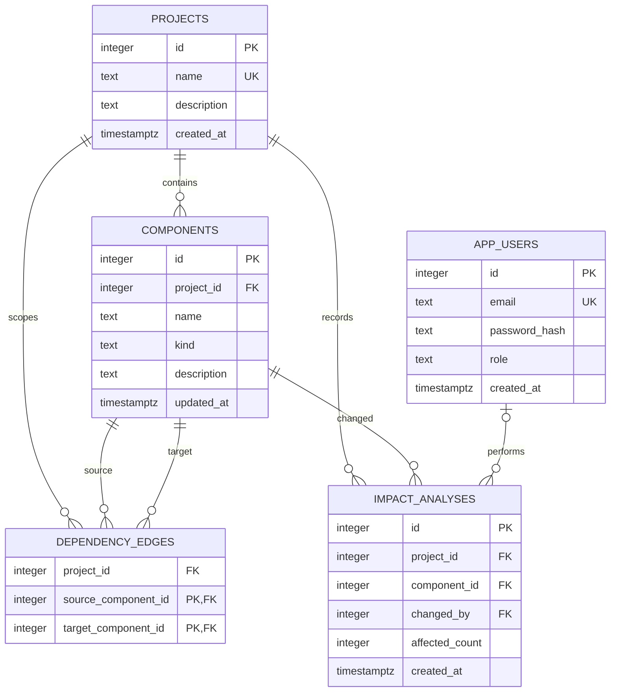

# Impact Atlas ER diagram

This diagram follows the target schema in `database/postgres/01_schema.sql`. A live check on 17 November 2026 confirmed that `dependency_edges.project_id` is NOT NULL and references `projects`; the composite same-project endpoint foreign keys shown by the DDL are not active in the current native database because the supporting unique `(project_id, id)` key is absent from `components`.

`dependency_edges` is a directed self-relationship over `components`, represented as a separate relation with a composite primary key. The DDL defines composite foreign keys requiring both endpoints to belong to `project_id`; those endpoint constraints are not active in the current live database. The DDL also defines a composite foreign key tying an impact analysis to a component in the same project, but that composite constraint is not active in the current database either. In the graph, a dependency is represented by `(source)-[:DEPENDS_ON]->(target)`. A source component depends on its target; impact traversal walks incoming relationships to find dependents.

The application user’s `role` is a checked text value (`admin` or `developer`), not a foreign key to PostgreSQL role objects. The PostgreSQL group roles are separate database principals described in `RELATIONAL_SCHEMA.md`.

