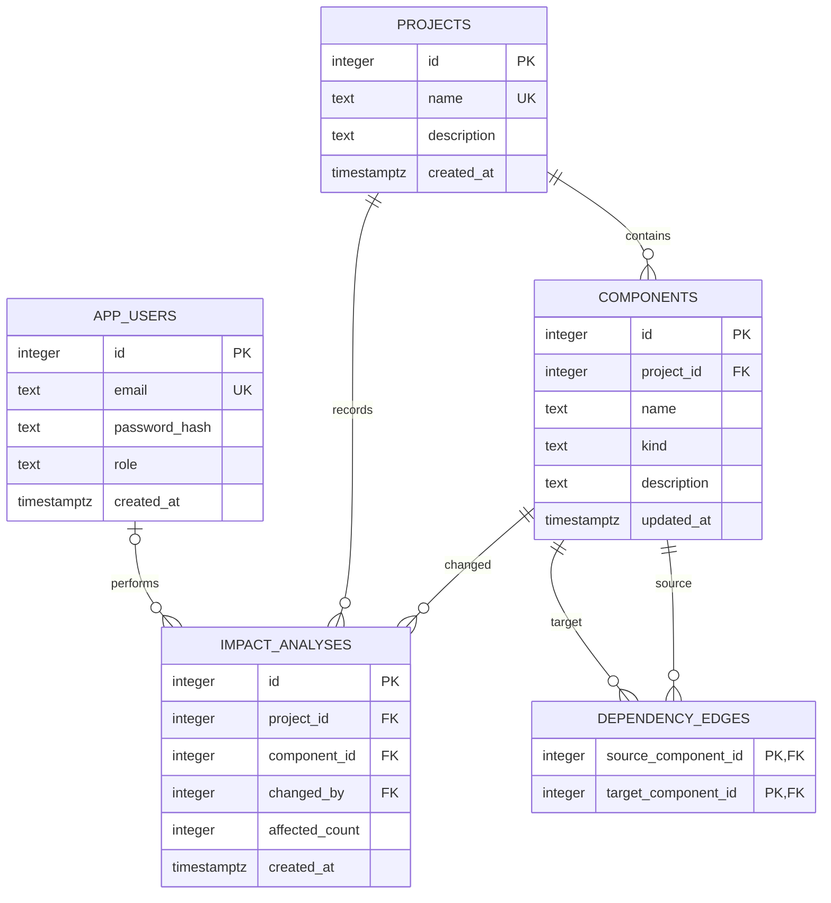

# Impact Atlas ER diagram

This diagram follows the repository’s PostgreSQL DDL (`database/postgres/01_schema.sql`) and was checked against the live database catalog.

`dependency_edges` is a directed self-relationship over `components`, represented as a separate relation with a composite primary key. In the graph, the same dependency is represented by `(source)-[:DEPENDS_ON]->(target)`. A source component depends on its target; impact traversal walks incoming relationships to find dependents.

The application user’s `role` is a checked text value (`admin` or `developer`), not a foreign key to PostgreSQL role objects. The PostgreSQL group roles are separate database principals described in `RELATIONAL_SCHEMA.md`.

